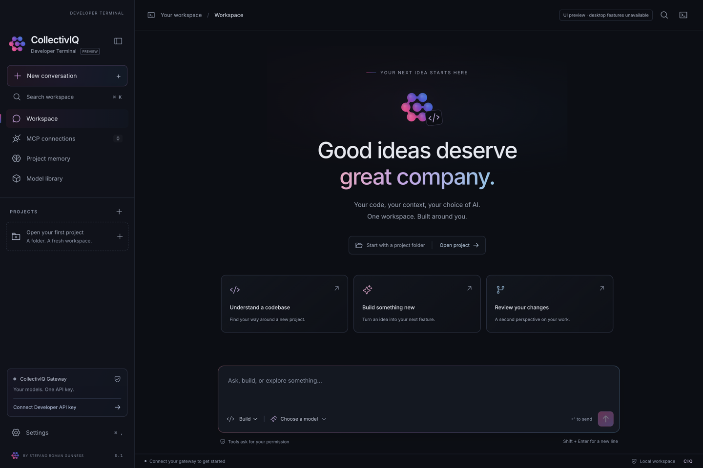

# CIQ Developer Terminal

### Created by Stefano Roman Gunness

**Your code. Your context. Your choice of AI.**

An independently designed, CollectivIQ-first desktop developer workspace with
a left sidebar, project conversations, editable project memory, MCP controls,
OpenCode's free coding models out of the box, and optional provider keys.

**Version 0.2.0 · Preview** · [Downloads](https://github.com/stefanoromang/ciq-developer-terminal/releases)
· [Build and installation](#build) · [Original OpenCode source](https://github.com/anomalyco/opencode)



## An original interface, with a credited open-source engine

The CIQ application interface and workflow are created for **Stefano Roman
Gunness**. The underlying coding engine is **[OpenCode 2.2.6](https://www.npmjs.com/package/@opencode/cli/v/2.2.6)**,
used under its **MIT license**. This is not a claim that the OpenCode engine
was originally written by Stefano, and it is not a full source fork or a
feature-parity release.

**Want to read or get a copy of OpenCode itself?**

- [Read / download the original OpenCode repository](https://github.com/anomalyco/opencode)
- [Read the official V2 documentation](https://opencode.ai/v2/docs/)
- [Read its MIT license](assets/licenses/OpenCode-MIT.txt)
- [How CIQ uses OpenCode and what this application adds](docs/OPENCODE.md)

This is an independent project, not an official OpenCode or CollectivIQ distribution.

## Downloads and platform status

Use the [GitHub Releases page](https://github.com/stefanoromang/ciq-developer-terminal/releases).
Windows x64 setup/portable, Linux x64 portable and macOS Apple Silicon packages
are built natively by the release workflow. Linux is tested on Ubuntu 22.04;
Debian desktop use still depends on the required libraries and sandbox support.
Downloads are **unsigned**, and the macOS preview is **not notarized**.

| Download | Format |
|---|---|
| [Windows x64 installer](https://github.com/stefanoromang/ciq-developer-terminal/releases/download/v0.2.0/CIQ-Developer-Terminal-0.2.0-windows-x64-setup.exe) | Per-user setup, no installer elevation |
| [Windows x64 portable](https://github.com/stefanoromang/ciq-developer-terminal/releases/download/v0.2.0/CIQ-Developer-Terminal-0.2.0-windows-x64-portable.exe) | Run without installing |
| [Linux x64 portable](https://github.com/stefanoromang/ciq-developer-terminal/releases/download/v0.2.0/CIQ-Developer-Terminal-0.2.0-linux-x64.tar.gz) | Extract and run as your user |
| [macOS Apple Silicon](https://github.com/stefanoromang/ciq-developer-terminal/releases/download/v0.2.0/CIQ-Developer-Terminal-0.2.0-mac-arm64.zip) | Extract into `~/Applications` |

See [download instructions](docs/DOWNLOADS.md) and
[0.2.0 validation/release notes](docs/RELEASE-0.2.0.md).

> **Updating from 0.1.2:** 0.1.2 has no updater. Install 0.2.0 once manually.
> From 0.2.0 onward, CIQ checks its GitHub releases about twice a week and can
> download and install newer versions itself.

## Features

- **Free models on first launch.** OpenCode's free coding models work without a
  CollectivIQ key or any other provider key.
- **Bring your own provider when you want one.** Add CollectivIQ or any provider
  the bundled engine exposes by pasting a key; keys are kept in CIQ's encrypted
  vault and injected only into the isolated engine.
- One left sidebar for projects, conversations, models, MCPs and memory.
- Daily, weekly or manual model checks, without changing conversation models automatically.
- Persistent local conversations and explicit, editable per-project notes.
- Permission requests before agent tools execute.
- **Automatic update checks** against this repository's releases, with
  checksum verification and a user-triggered restart.
- User-level installation; no administrator installer elevation.

## What you need

- **Nothing, to start.** Free OpenCode models are enabled by default. They are
  rate-limited by OpenCode and can change or be unavailable at times.
- **Optional:** a CollectivIQ Developer/Gateway API key for reliable access to
  your account's models, or an API key for another supported provider.
- macOS, a desktop Debian/Linux environment, or Windows supported by Electron 45 and the bundled engine.
- Local MCP commands may need separately installed runtimes. No npm, Python, Git or system-library installation happens silently.

The CollectivIQ endpoint is preconfigured as `https://api.prod.collectiviq.ai/v1`.
When a key is supplied, the app validates it with `GET /models`. **Standard
platform keys are not model gateway keys.** Best of the Best is offered only if
the catalog exposes it. No model IDs are invented or hard-coded.

## Build

Use Node 24 or newer, on the OS and architecture you are packaging:

```sh
npm ci
npm run build
npm test
npm run test:desktop
npm start
```

If your npm installation blocks dependency lifecycle scripts, review `node_modules/@opencode/cli/postinstall.mjs`, then run it explicitly. It selects and verifies the pinned native engine for the current OS/CPU:

```sh
node node_modules/@opencode/cli/postinstall.mjs
```

## User-only installation

### macOS

```sh
npm run package:mac
npm run install:user
open "$HOME/Applications/CIQ Developer Terminal.app"
```

The installer creates `~/Applications/CIQ Developer Terminal.app`, never writes to system `/Applications`, and refuses to overwrite an existing app. For distribution, build the ZIP on macOS and have the developer sign and notarize it. **This local preview is unsigned/not notarized**; Gatekeeper can warn. Do not disable Gatekeeper or strip quarantine as an installation step.

### Debian / Linux

```sh
npm run package:linux
npm run install:user
```

Produces a portable tarball, with user installation under `~/.local/opt/ciq-developer-terminal`, a `~/.local/bin` launcher, and a user desktop entry. No `apt`, `.deb` installation, root or `sudo`. Electron still needs normal desktop system libraries and a working unprivileged Chromium sandbox. Restricted systems without those prerequisites may need IT support; **CIQ does not fall back to `--no-sandbox`**.

For a downloaded Linux tarball, extract it to a new directory and run `./ciq-developer-terminal` there; no installation is required. User desktop-entry installation is optional.

### Windows

```powershell
npm run package:win
```

Run the generated NSIS setup as a normal user, choosing a folder inside your profile, or use the portable executable. `perMachine:false` and `allowElevation:false` prohibit installer elevation. Unsigned builds can trigger SmartScreen. Windows packaging must be validated on Windows; a macOS build does not establish Windows support.

The workflow in `.github/workflows/build.yml` builds native artifacts on separate OS runners. A configured workflow is not evidence that every target has passed validation; check the Actions results and release notes.

## Workflow

1. On first launch, choose **Use free models** to start with OpenCode's free
   models immediately. No key is required.
2. Optional: connect a CollectivIQ Developer/Gateway key, or add another
   provider in **Model library → Connect another provider**.
3. Optionally enable tools for gateway models whose catalog omits capability
   metadata, **only if your gateway supports OpenAI tool calls**. Unknown models
   otherwise start chat-only; declared chat-only models never get tools forced on.
4. Choose a model, then open a project folder. Each project has its own
   conversation list and editable notes.
5. Add MCP servers in **MCP connections**. New servers stay disconnected until explicitly connected. Local commands execute as your user; review them before connecting. Remote servers can use OAuth when advertised. API-key-header MCP connections are not implemented in this preview.
6. Choose daily, weekly or manual model refresh. Checks happen while CIQ is open and catch up after relaunch. The previous successful inventory survives failures. Existing conversation selections never change automatically.
7. CIQ checks this repository's GitHub releases about twice a week, catches up
   on launch, and downloads a newer version when one exists. The download is
   SHA-256 verified. CIQ asks before restarting to install; it does not silently
   replace itself mid-session.

### Memory and privacy

- Conversation history persists in the isolated local OpenCode database. The visible timeline loads the latest 80 messages and can page earlier messages; this is separate from model context compaction.
- Project memory is **explicit user-edited notes**, not an unbounded or hidden automatic memory system. Notes can be disabled per project. Enabled notes are included in that project's new model prompts.
- Saved gateway keys are encrypted through Electron `safeStorage`. macOS uses Keychain-backed protection; Windows uses DPAPI; Linux requires a secure available backend. `basic_text` is rejected. Session-only mode keeps the key in memory and requires reconnection after quitting.
- This preview has no telemetry or cloud history sync. Prompt content, project context required by tools, and enabled notes are sent to the selected gateway model; connected remote MCP servers receive their tool inputs.
- Filesystem, shell and MCP tool requests require explicit permission in the interface. A subprocess still runs with the current user's OS permissions: this is **not an OS filesystem sandbox**. The renderer is sandboxed.
- The command panel executes commands you explicitly submit. It is a non-interactive shell output panel, not a PTY terminal emulator.
- The private engine uses its own config/data/cache/state paths and a loopback API password. The existing OpenCode installation and global config are not changed. Project-local `AGENTS.md`, skills and `opencode.json(c)` are still discovered by the engine; open only projects you trust.

## Current limitations

- Not full OpenCode parity: no diff/revert viewer, PTY emulator, file attachment UI, provider OAuth/account manager, automatic project-memory extraction, or team sync.
- Free model availability, model names and rate limits are controlled by OpenCode and can change without notice. A `429` free-usage limit is reported as a rate limit, not as a broken key.
- Third-party providers are connected by API key only in this preview. Providers that require browser OAuth or an external command are not offered in the provider dialog.
- Automatic updates install only releases that contain a matching platform asset and a SHA-256 checksum file. 0.1.2 users must install 0.2.0 manually once.
- No latency, RAM, or package-size improvement over OpenCode has been established. Electron and the native engine are substantial dependencies. The frontend itself is bundled locally without remote scripts or analytics.
- Live gateway and live free-model generation depend on the provider. Fixtures and local engine tests do not establish live provider compatibility, pricing, account entitlement, or consensus availability.
- Release signing/notarization, validation on a Debian host and broader end-user OS coverage remain release tasks. Windows and Ubuntu Linux native CI smoke tests pass for the published x64 previews.

Brand assets and colors are sourced from CollectivIQ's official site. See `THIRD-PARTY-NOTICES.md` and `docs/IMPLEMENTATION-PLAN.md` for provenance and architecture.

## Authorship and licenses

**CIQ Developer Terminal — created by Stefano Roman Gunness.**

The original application code is published for inspection with rights reserved,
as stated in [LICENSE](LICENSE). This is a source-visible project, not a blanket
open-source license for the original CIQ application. Third-party components
retain their own licenses; notably, **OpenCode remains MIT-licensed**. No
ownership of OpenCode or CollectivIQ trademarks is claimed.

See [THIRD-PARTY-NOTICES.md](THIRD-PARTY-NOTICES.md),
[SECURITY.md](SECURITY.md), and [the validation report](docs/VALIDATION.md).
